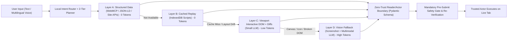

# PandaPilot — Technical Architecture, Implementation Plan & Undergrad Engineering Guide

**Event:** wHACKiest 2026 Online Ideathon (26–27 Nov 2026) — Ramaiah Institute of Technology (CodeRIT)  
**Track:** Track 2 — Beyond the Browser  
**Team Name:** PandaPilot | **Team ID:** `e17b46ca` | **College:** SSN College of Engineering  
**Team Members:** Mithin Krishna PS (Lead, `3122255002067`), Raghav Karthick (`3122255002092`), Afsheen S (`3122255002005`), Akshay R (`[ADD USN BEFORE EXPORT]`)

---

## 1. Executive Overview & Product Identity

### One-Line Definition
**PandaPilot** is a privacy-first, one-click Chrome extension (Manifest V3) with text and pan-Indian multilingual voice support that unifies four daily web workflows—smart discovery, visual multi-tab comparison, simplified form completion, and cached task replay—inside a layered, low-cost, zero-trust agent architecture.

### Why a Chrome Extension (Not a Standalone AI Browser)?
The 2026 browser-agent market has already demonstrated a decisive product lesson: **distribution beats novelty**.
* **ChatGPT Atlas (OpenAI):** Launched Oct 2025 as a macOS Chromium browser; retired Aug 2026 (~292 days later) as OpenAI moved agentic browsing into a Chrome extension and desktop/Codex apps.
* **Project Mariner (Google DeepMind):** Unveiled Dec 2024, rolled out May 2025 behind an expensive tier (~$250/mo), and shut down in May 2026 as capabilities were absorbed into Gemini and Chrome auto browse.

Users refuse to abandon their existing browser, saved logins, bookmarks, and muscle memory. Building a **Chrome Extension (MV3) with a Side Panel and Shadow DOM overlay** inherits the user's authenticated sessions immediately, requires zero browser maintenance or security-patch burden, and installs in one click via the Chrome Web Store.

### Scope Discipline: What We Kept vs. Cut
To avoid solving too many problems poorly, PandaPilot anchors its **4 user-facing modes** in **4 tightly integrated technical pillars**:
1. **Layered Cheapest-First Engine** (WebMCP/JSON-LD → Cached Replay → Viewport-Only Diffed DOM → Vision Fallback).
2. **Zero-Trust Security** (CaMeL-inspired Reader/Actor separation + mandatory Pre-Submit Re-Verification Safety Gate).
3. **Source-Anchored Whiteboard Nodes + Deterministic True-Cost & Dark-Pattern Checks**.
4. **Local Persona Vault + Zero-Leak PII Masking**.

*(Experimental side ideas from early brainstorming—such as a standalone Free-Tier/Paywall Radar and generic full-site Broken-Page Label Repair—were deliberately cut to keep the architecture cohesive and pitchable.)*

---

## 2. Deep Dive: The 4 Auto-Routed Modes

Instead of forcing users to configure complex automation workflows, PandaPilot uses a lightweight **Local Intent Router** (combining the user's text/voice prompt, active tab URL/DOM signals, and open tabs) to route into one of four cohesive modes:

### Mode 1: Finding What Matters (Smart Discovery)
* **User Experience:** The user speaks or types a messy, real-world intent (e.g., *"Find me beginner-friendly Rust embedded tutorials with hands-on projects"* or *"Best budget broadband plans in Chennai with no installation trap"*). PandaPilot navigates across approved or user-selected result tabs, strips ad clutter/SEO filler, and surfaces a concise, ranked shortlist highlighting what actually matches their criteria.
* **Under the Hood:**
  * Reads structured metadata first (JSON-LD, OpenGraph, page headings, WebMCP tools if exposed) before reading raw body text.
  * Runs through the **Untrusted Reader** pipeline so promotional text or hidden SEO spam cannot hijack the agent.
  * Every recommendation includes clickable **source anchors** back to the exact section on the site.

### Mode 2: Purchasing & Planning (Interactive Visual Whiteboard)
* **User Experience:** Instead of drowning in 35 open tabs and mental math, the user clicks **"Map Tabs to Whiteboard"** (or gives a comparison prompt). Inside the Chrome Side Panel (expandable to full-tab view), PandaPilot generates an **interactive visual whiteboard** of clickable product/service nodes linked to the user's central goal. Clicking any node inspects normalized pricing, verified specs, and dark-pattern warnings—or jumps straight to the highlighted element on the live source tab.
* **Under the Hood:**
  * **Source-Anchored Extraction:** Code extracts prices, billing periods, setup fees, and contract lengths tied to CSS/DOM selectors. Missing fields explicitly display *"Not stated on this page"* (never hallucinated).
  * **Deterministic True-Cost Normalization:** Pure code—not an LLM—converts monthly, quarterly, and annual pricing into a single normalized monthly + 1st-year total cost (factoring in setup fees, shipping, and stated taxes/GST).
  * **Deterministic Dark-Pattern & Hidden-Fee Checks:** Three zero-token code checks flag:
    1. Pre-ticked add-on checkboxes (e.g., warranty, insurance, router rental).
    2. Late checkout fees absent from the initial listing page.
    3. Auto-renewal / tricky opt-out wording.

### Mode 3: Applying & Registering (DAP-Style Form Co-Pilot)
* **User Experience:** Complex college portals, scholarship applications, and hackathon registrations are intimidating and repetitive. PandaPilot acts like a **Digital Adoption Platform (DAP)** overlay + side-panel assistant:
  * **Focus Mode:** Collapses an overwhelming 40-field webpage into calm, one-step-at-a-time cards in the side panel, syncing answers back to the live DOM.
  * **Shadow DOM Spotlight:** Gently dims background clutter on the live page and highlights the active field/next button without altering the site's underlying HTML.
  * **Persona Vault Switching:** Automatically distinguishes **College/Academic** vs. **Personal** vs. **Hackathon/Work** identities based on domain/field clues (e.g., `.edu.in` or *"Roll Number"* → College persona) with a 1-click **"Accept All"** bar and click-to-switch overrides.
  * **Pan-Indian Multilingual Voice-to-Form:** Users can tap the mic and speak naturally in **English, Hindi, or Tamil/Tanglish** (via Web Speech API `en-IN`, `hi-IN`, `ta-IN`, structured to plug into Bhashini/cloud ASR) to fill long descriptive boxes (e.g., *"Why should we select your team?"*) with clean, formatted English or regional text.
* **Under the Hood:**
  * **Zero-Leak PII Masking:** Only blank field labels/schema (e.g., `[field_1: "Institutional Email", field_2: "USN / Roll No"]`) are sent to the cloud LLM for mapping; real PII stays encrypted inside `chrome.storage.local` and is injected strictly on-device.

### Mode 4: Cached Repeated Automations (Cache & Replay)
* **User Experience:** Tasks like submitting weekly lab assignments on an LMS (Moodle/Google Classroom/Canvas), logging into a campus portal, or filling recurring hackathon/internship forms follow the exact same DOM steps every time. The first time PandaPilot executes a flow (with user review), the user clicks **"Save Workflow"**. Every future run executes in seconds via **1-click replay**—stopping at the final **Consent Gate** before hitting Submit.
* **Under the Hood:**
  * Stores a deterministic action graph (URL pattern + structural selector fingerprints + persona field keys + expected post-step assertions) locally in `IndexedDB`.
  * Replays the sequence at **₹0 AI token cost** and near-zero latency.
  * Runs a lightweight deterministic validator after each step; if a portal updates its layout and a selector fails, it gracefully falls back to Layer C (DOM LLM) to self-heal that single step and offers to update the cache.

---

## 3. System Architecture & The 4-Layer Cheapest-First Engine

### Why Token Architecture Matters (The Research Basis)
Recent browser-agent benchmarks show that perception dominates both latency and API cost—and naive text dumps can actually cost *more* than images:
* **1 Full-Page Screenshot:** ~1,000 to 1,400 tokens regardless of DOM complexity.
* **Naive Full Accessibility Tree:** Costs **2.8x to 14.5x** a screenshot (e.g., ~9,900 tokens on Hacker News vs. ~2,700 for scrolling screenshots; ~19,700 tokens on Stripe's pricing page).
* **Viewport-Only Interactive Tree:** ~580 tokens on Wikipedia vs. ~12,700 for the full tree (**>95% token reduction**).

Therefore, PandaPilot enforces a strict **cheapest-first execution waterfall**: never call a big model when code, cache, or structured metadata can do the job.

### The 4 Execution Layers Explained
1. **Layer A — Structured Interfaces (₹0 AI cost):** Checks if the site exposes **WebMCP** tools (emerging W3C draft standard previewed in Chrome 146/149), **JSON-LD / Schema.org** product/offer objects, or clean semantic tables. Deterministic regex + DOM parsers extract facts directly.
2. **Layer B — Cached Replay (₹0 AI cost):** Matches the current domain + task intent against saved `IndexedDB` workflow recipes (inspired by *Agentic Plan Caching*, which demonstrated ~50% lower cost and 27% lower latency in research workloads, and Stagehand's action caching). Replays steps deterministically with selector validation.
3. **Layer C — Viewport-Scoped Interactive DOM + 2-Tier Model Routing (Low cost):** Strips decorative nodes, CSS classes, hidden text, and duplicate subtrees. Assigns numeric IDs strictly to **visible, interactive elements** inside the current viewport and sends only **DOM diffs** after actions. A small/fast model (**Gemini Flash**) executes routine extraction/mapping, escalating to a stronger model (**Gemini Pro**) only for complex multi-step planning or error recovery.
4. **Layer D — Vision Fallback (Used Sparingly):** Captures a viewport screenshot only when a control is rendered inside `<canvas>`, an unlabeled icon button, or heavily obfuscated markup where DOM extraction fails.

---

## 4. Security & Privacy Engineering

Live browser agents face two existential risks documented in 2026 security studies (University of Washington SOP bypass study; Zenity Labs "PleaseFix" prompt-injection attacks):
1. **Indirect Prompt Injection:** Malicious text hidden inside a webpage (`display:none`, white-on-white text, or adversarial reviews) tricks an agent inside the user's logged-in browser into leaking emails, changing cart items, or clicking unauthorized links.
2. **PII Leakage & Irreversible Actions:** Sending personal forms/resumes to cloud LLMs or accidentally submitting payments/assignments.

PandaPilot mitigates these through **three structural controls** (framed honestly as *limited blast radius by design*, not "100% solved"):

### Control 1: CaMeL-Inspired Reader / Actor Privilege Separation
Inspired by Google DeepMind's **CaMeL (Defeating Prompt Injections by Design)** architecture:
* **Untrusted Reader Zone (Content Script + Extraction LLM):** Reads raw DOM text and interactive labels. It has **zero** access to `chrome.storage` credentials, **zero** tool permissions to click/submit/navigate, and cannot execute arbitrary instructions found on the page.
* **Schema Boundary (Pydantic Validator):** All data crossing from the Reader to the Trusted side must pass a strict JSON schema (typed prices, element IDs, boolean flags—no free-form executable commands). A deterministic scanner also flags suspicious imperative strings aimed at AI agents (e.g., *"Ignore previous instructions..."*) and isolates them as plain display text.
* **Trusted Actor Zone (Extension Service Worker + Side Panel):** Enforces a **code-level domain allowlist** (only tabs the user explicitly approved or opened for the task). Executes clicks/fills solely based on structured IDs approved by the user.

### Control 2: Zero-Leak PII Masking
When Mode 3 (Form Co-Pilot) needs AI help to map an unfamiliar portal's form fields:
1. **Local Extraction:** The content script extracts only the form's structural schema: `{ id: "inp_3", label: "Candidate Reg No", placeholder: "Enter 13-digit ID", type: "text" }`.
2. **Cloud Mapping (Zero PII):** Only those blank labels are sent to FastAPI → LLM. The LLM returns a mapping key: `{ "inp_3": "persona.college.usn" }`.
3. **Local Injection:** Back inside the user's browser, the Trusted Actor unlocks the encrypted local Persona Vault (via Web Crypto API) and injects `"3122255002005"` directly into `#inp_3`. **Zero bytes of raw PII ever touch the backend or LLM.**

### Control 3: Mandatory Pre-Submit Safety Gate & Re-Verification
* **Hard Credential Boundary:** PandaPilot explicitly refuses to read, store, or auto-fill **passwords, OTPs, banking PINs, or CVV/card numbers** (`input[type="password"]`, sensitive domains). It pauses for a mandatory human hand-off.
* **Pre-Submit Summary + Just-in-Time Re-Check:** Before clicking any consequential button (*Place Order*, *Submit Assignment*, *Confirm Application*), PandaPilot displays a plain-English summary card. When the user clicks **Confirm**, the extension **re-reads the live target button text and final total/payload milliseconds before clicking**—and immediately aborts if a dynamic script changed the price or swapped the button underneath.

---

## 5. Complete Tech Stack

| Layer | Technology Choice | Why We Picked It | Undergrad-Friendly Explanation |
| :--- | :--- | :--- | :--- |
| **Extension UI & Overlay** | **Chrome Extension (Manifest V3)**, Side Panel API, **React + TypeScript** (or Vite), **Shadow DOM** | Inherits user logins; zero browser switching; Shadow DOM isolates PandaPilot's highlights/arrows from breaking the host site's CSS. | Think of Chrome MV3 as the "chassis": Side Panel is our app window, Content Script reads the page, Shadow DOM draws safe visual highlights on top. |
| **Visual Whiteboard (Mode 2)** | **React Flow** (or Cytoscape.js) + custom SVG/HTML nodes | Built-in pan/zoom, draggable node graphs, clickable edges, and custom rich cards inside the Side Panel. | Turns a flat comparison table into an interactive node-and-wire whiteboard like Figma/Miro inside Chrome. |
| **Multilingual Voice (Mode 3)** | **Web Speech API** (`en-IN`, `hi-IN`, `ta-IN`) + **Bhashini / Cloud ASR** interface | Zero-cost native browser speech recognition & TTS for MVP; cleanly modularized so Bhashini API can drop in for deeper Indian dialect accuracy. | Browser mic captures Tamil/Hindi/English speech; our normalizer converts Tanglish/regional speech into clean form answers. |
| **Local Vault & Cache** | `chrome.storage.local` + **`IndexedDB`** + **Web Crypto API** (AES-GCM) | Keeps Persona Vault encrypted on-device with zero server DB PII risk; IndexedDB handles larger cached workflow graphs cleanly. | Your personal details and saved LMS scripts live in an encrypted mini-database right inside your own Chrome browser. |
| **Thin Backend** | **Python 3.11+**, **FastAPI**, **Uvicorn**, **Pydantic**, **SQLite** (MVP) → Redis/Postgres (Scale) | Keeps LLM API keys secure off the extension; Pydantic enforces strict JSON schemas; SQLite caches anonymized route/prompt prefixes. | A lightweight traffic controller in Python that talks to the AI models, validates JSON outputs, and protects our API keys. |
| **AI / ML Routing** | **2-Tier LLM Cascade** (**Gemini Flash** default + **Gemini Pro** planner + **Vision** fallback) + **WebMCP** hooks | Balances speed/cost (Flash for DOM diffs & field mapping) with reasoning (Pro for ambiguous plans); WebMCP future-proofs structured sites. | Use a fast, cheap "junior assistant" AI for routine clicks/extraction and only wake up the expensive "senior architect" AI when stuck. |
| **Cloud & Hosting** | **Cloud Run / Render / Fly.io** (Free Tier) or local Uvicorn for hackathon demo | Stateless backend scales to zero when idle, keeping MVP cloud cost at ₹0. | Because the backend stores no user accounts or personal files, we can host it for free on serverless containers. |
| **Testing & Eval** | **Playwright** + Node/Pytest unit tests | Automates true-cost math verification, prompt-injection rejection tests, and live-task success/token benchmarking. | Scripts that automatically test our true-cost calculator and run fake prompt-injection attacks to prove our Safety Gate catches them. |

---

## 6. End-to-End Data Flows (Step-by-Step Walkthroughs)

### Flow A: Mode 2 — Visual Whiteboard Comparison ("Compare 3 Broadband Plans")
1. **Input:** User opens 3 ISP tabs (or types *"Compare these 3 broadband tabs for best 1-year value"*).
2. **Router & Allowlist:** Local Router selects **Mode 2 (Decision Canvas)** and locks the allowlist to those 3 approved tab origins.
3. **Read (Layer A → C):** Content scripts parse JSON-LD/DOM tables in each tab (Untrusted Reader). Only visible pricing blocks and checkbox states are extracted.
4. **Deterministic Processing:** Code normalizes billing cycles (e.g., `₹799/mo + ₹1,000 setup + 18% GST` vs. `₹8,999/yr`) into an apples-to-apples **Effective Monthly Cost** and **1st-Year Total**. Deterministic detectors flag pre-ticked router insurance and auto-renew fine print.
5. **Output:** Side Panel renders the **Visual Whiteboard**: Central Goal Node → 3 clickable Plan Nodes (*Best Value*, *Balanced*, *Hidden Fee Warning*). Clicking any price pill scrolls and highlights the exact source element on that ISP tab.

### Flow B: Mode 3 & Mode 4 — Guided Form + Cached LMS Replay
1. **Input (First Visit):** User opens a messy college hackathon/LMS portal and toggles **Form Co-Pilot**.
2. **Read & Mask:** Content script extracts blank form field labels (`Name`, `College Email`, `Department`, `Why join?`). No values leave the browser.
3. **Map & Voice:** FastAPI + Gemini Flash maps labels to Persona keys (`persona.college.*`). User taps mic for the essay box and speaks in **Tamil/Tanglish**: *"Naanga AI browser extension build panrom..."* → transcribed and refined into crisp English in a review card.
4. **Preview & Consent Gate:** Floating bar shows **"Accept All (6/6 fields)"** + click-to-switch between *College* and *Personal* personas. User approves; Local Actor fills DOM fields and pauses before **Submit** for final human confirmation.
5. **Save & Future Replay (Mode 4):** User saves the mapping as *"Campus Portal Submission"*. Next week, Layer B replays the entire mapping locally in <1 second at **₹0 LLM tokens**, stopping cleanly at the Consent Gate for final submission.

---

## 7. Phased Execution Roadmap: Round 1 → Round 2 → Beyond

| Phase | Goal | Exact Scope |
| :--- | :--- | :--- |
| **Phase 1: Round 1 Ideathon Submission (Current)** | Win Round 1 selection with clear architecture + irresistible visual proof of concept. | • Polished 8-slide PPT following wHACKiest 2026 template. • **High-Fidelity Interactive Frontend Prototype:** Sleek web-based "Simulated Chrome Browser + PandaPilot Side Panel" demonstrating all 4 modes interactively (clickable Visual Whiteboard nodes, Persona switch + simulated Tamil voice-to-form, Discovery cards, and Cached LMS Replay with Safety Gate abort demo). Zero backend fragility. |
| **Phase 2: Round 2 — 24-Hour Hackathon Build (26–27 Nov)** | Deliver a real working Chrome Extension + FastAPI backend without overbuilding. | • Real **Chrome MV3 Extension** (Side Panel + Content Script + Shadow DOM). • Real **FastAPI backend** with 2-tier Gemini routing + Pydantic schema guard. • **Live working core:** Mode 2 Visual Whiteboard + Deterministic True-Cost/Dark-Pattern checks on 3 controlled mock/live sites + Mode 3 Local Persona Vault & Web Speech Tamil/English voice fill + Mode 4 Cached Replay on a mock LMS + Safety Gate live abort test. • Recorded backup demo video + 3-step README. |
| **Phase 3: Post-Hackathon Scale** | Production readiness & monetization. | • Chrome Web Store launch with BYOK + Pro cloud tier. • Bhashini integration for 10+ Indian languages. • WebMCP native tool adoption as sites roll it out. • B2B Campus/Enterprise verified workflow pack marketplace. |

---

## 8. Strengths, Weaknesses & Judge Q&A Playbook

### Honest Engineering Assessment (For Your Team)
* **Strengths:**
  1. **Grounded in 2026 Industry Reality:** You aren't naively pitching "another AI browser" (which Atlas and Mariner already proved fails). You're pitching a lightweight extension with layered cost control and privilege separation.
  2. **Differentiated UX:** Replacing chat walls-of-text with a **Visual Whiteboard** (Mode 2) and solving **multi-persona + regional voice** (Mode 3) hits pain points Google/OpenAI gloss over.
  3. **Zero-Token Core Math:** Deterministic true-cost conversion, dark-pattern flags, and cached replay mean your core value prop doesn't hallucinate prices or burn tokens on repeat tasks.
* **Weaknesses / Realistic Limits (Own These Openly):**
  1. **Web Speech API Limitations:** Browser-native `SpeechRecognition` still relies on browser vendor cloud services, requires Chrome desktop support, and Tanglish (code-mixed Tamil+English) can vary by mic quality—requiring a clean fallback/manual edit box (and Bhashini post-MVP).
  2. **Brittle Selectors in Mode 4:** Websites redesign their HTML frequently. Cached scripts can break unless paired with self-healing DOM fallback (Layer C).
  3. **Prompt Injection Is Not "Solved":** Even CaMeL-style Reader/Actor isolation reduces blast radius rather than eliminating every adversarial edge case—which is why mandatory human confirmation before submit/pay is non-negotiable.
  4. **Anti-Bot / CAPTCHA Barriers:** Real e-commerce sites (Amazon/Flipkart) aggressively block automated background fetching; demos must respect active user tabs, allowlists, and controlled pages rather than claiming "we scrape the entire internet silently."

### Tough Judge Questions & Crisp Answers

1. **Q: "Chrome already has Gemini auto-browse, and Perplexity has Comet. Why does PandaPilot need to exist?"**
   * **A:** "General assistants give you a linear chat stream and process your session in the cloud behind expensive paid tiers ($17–$250/mo) with English-first UX. PandaPilot focuses on three gaps they leave wide open: **(1)** an interactive, source-anchored **Visual Whiteboard** instead of scrolling chat summaries; **(2)** **Zero-Leak Local Persona Vaults** (College vs. Personal) with **Tamil/Hindi/English voice** for everyday Indian portals; and **(3)** **₹0 Cached Replay** for repeat student/office workflows."

2. **Q: "Isn't solving 4 modes too broad for an undergrad team?"**
   * **A:** "Notice they aren't 4 separate products—they share **one single 4-layer engine**. Mode 1 and Mode 2 use the exact same Reader + Structured Extractor; Mode 3 and Mode 4 use the exact same Local Vault + Deterministic Actor. For our 24-hour Round 2 MVP, we build the core engine once and expose focused flows cleanly—and for Round 1, our interactive frontend prototype clearly demonstrates the end-to-end UX."

3. **Q: "If you claim 'privacy-first', why do you have a Python FastAPI backend?"**
   * **A:** "Two reasons every production Chrome extension needs one: **(1)** you cannot safely ship LLM API keys inside client-side Chrome extension code because anyone can inspect the bundle and steal your keys; and **(2)** our FastAPI layer enforces strict **Pydantic schema validation** as an untrusted-to-trusted firewall. Crucially, the backend is **stateless with zero PII storage**—only blank form labels or anonymized DOM snippets cross over, while your personal vault stays encrypted inside `chrome.storage.local`."

4. **Q: "How do you stop a malicious website from hijacking the agent via prompt injection?"**
   * **A:** "We never claim prompt injection is 100% solved—OpenAI and DeepMind both treat it as an ongoing challenge. Instead, we design for **bounded blast radius**: **(1)** Reader/Actor privilege separation (the component reading untrusted pages has zero click/credential tools); **(2)** domain allowlists enforced in code, not prompts; **(3)** deterministic regex scanner ignoring hidden prompt text; and **(4)** a Pre-Submit Safety Gate that re-reads the final button and price milliseconds before clicking."

5. **Q: "What happens when a university LMS or portal updates its HTML and breaks your Cached Replay?"**
   * **A:** "Each cached step stores both a primary selector and structural context (label text + nearby landmarks) plus a cheap deterministic post-step check. If a replay step fails its check, PandaPilot doesn't blindly click random buttons—it falls back to **Layer C (Viewport DOM LLM)** to locate the moved element, asks the user to confirm, and offers to patch the cached recipe locally."

6. **Q: "How do you prevent LLM API bills from bankrupting you on a free tier?"**
   * **A:** "Our architecture is **cheapest-first**: extraction, true-cost math, dark-pattern checks, and cached LMS replays consume **zero AI tokens**. When AI is needed, we send viewport-only interactive diffs (shrinking ~12k-token trees down to ~600 tokens) to a fast small model, reserve strong models for rare planning, enforce strict per-user daily caps on the free tier, and monetize heavy users via Pro and B2B Campus packs."
